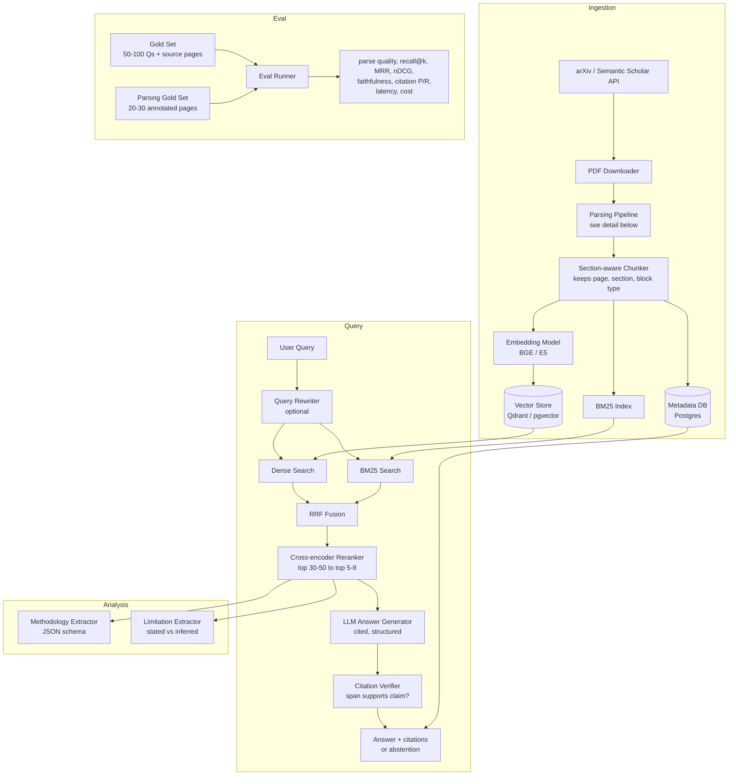

# Research_Paper_Intelligence_Platform
Gen AI: A system that searches academic papers, retrieves evidence, answers questions with page-level citations, compares methodologies, and identifies limitations. Skills: RAG, embeddings, reranking, vector search, evaluation, FastAPI.

# Research Paper Intelligence Platform

A retrieval-augmented system that searches academic papers, answers questions with **page-level citations**, compares methodologies across papers, and surfaces limitations. It includes a **layout-aware parsing pipeline with per-page quality scoring**, and an evaluation harness so every component's contribution is quantified.

> **Status:** in development. Results tables below are templates, to be filled from `make eval`.

---

## Features

- **Paper discovery and ingestion** from arXiv and Semantic Scholar, with async PDF processing
- **Layout-aware parsing pipeline**: page classification, parser routing, per-page quality scoring, and repair, handling two-column layouts, tables, and equations
- **Page-aware chunking**: every chunk keeps paper ID, section, block type, and page range
- **Hybrid retrieval**: dense embeddings + BM25, fused with Reciprocal Rank Fusion
- **Cross-encoder reranking** of the top candidates
- **Cited answers**: each claim carries `[Paper, p. N]`, checked by a verification pass
- **Abstention**: the system declines to answer when evidence is weak
- **Methodology comparison**: structured extraction (dataset, model, metrics, baselines) into a table
- **Limitation identification**: author-stated limitations and model-inferred gaps, labelled separately
- **Evaluation harness**: parsing, retrieval, and generation metrics with component ablations

---

## Architecture



### Parsing pipeline (detail)

PDFs are the weakest link in most RAG systems: two-column layouts interleave text, tables flatten into noise, and equations turn into garbled symbols. Rather than writing a new parser, this project runs a **detect, route, score, repair** pipeline.

```mermaid
flowchart LR
    PDF[PDF page] --> CL[Page Classifier<br/>text | two-column | table-heavy |<br/>equation-heavy | scanned | figure-heavy]
    CL --> RT{Parser Router}
    RT -->|born-digital, simple| P1[PyMuPDF / pdfplumber<br/>words + coordinates]
    RT -->|complex layout| P2[Layout-aware parser<br/>Docling / Marker / MinerU]
    RT -->|structure + references| P3[GROBID]
    RT -->|scanned| P4[OCR fallback]
    P1 --> QS[Quality Scorer]
    P2 --> QS
    P3 --> QS
    P4 --> QS
    QS -->|score below threshold| RT
    QS -->|ok or best effort| RP[Repair Stage]
    RP --> OUT[Typed blocks<br/>text, table, equation, caption,<br/>reference, with bbox, page, order]
```

| Problem | Handling |
|---|---|
| Two-column layouts | Cluster word x-coordinates to detect columns and reorder column by column, or take reading order from a layout model |
| Tables | Detect table regions, extract rows/columns into Markdown or JSON, store as separate `table` chunks linked to their captions; never merged into prose |
| Equations | Convert to LaTeX with a formula-recognition model, or keep an image reference with an `[EQUATION]` placeholder; garbled symbol text is kept out of embeddings |
| Headers, footers, page numbers | Remove text repeated at the same position across pages |
| Hyphenation and line breaks | Rejoin hyphenated words and merge lines within paragraphs |
| Figures | Keep captions as their own chunk type, linked to the figure number |
| References | Detect and route to a separate index so they do not pollute answers |

**Quality scorer (per page).** Cheap signals decide whether a page needs a stronger parser or should be flagged:

- ratio of non-dictionary or garbled tokens
- share of single-character fragments (typical of broken equations)
- reading-order sanity (do sentences continue across block boundaries?)
- column-interleaving patterns
- agreement between two parsers (low agreement marks a hard page)
- optional: an LLM or vision model comparing the rendered page image to the extracted text

Low-scoring pages are retried with a stronger parser; pages that still fail are flagged in metadata (`parse_quality`) so retrieval and answering can treat them with lower confidence.

### Design decisions

| Decision | Choice | Why |
|---|---|---|
| Parsing | Multi-parser routing with quality scoring | No single parser handles all layouts; scoring limits the cost of stronger parsers to hard pages |
| Chunking | By section, 300-500 tokens, small overlap; tables and equations as separate block types; page range stored | Preserves meaning; page citations require page metadata at ingestion |
| Retrieval | Hybrid (dense + BM25) | Dense handles paraphrase; BM25 handles exact terms like model names and acronyms |
| Fusion | Reciprocal Rank Fusion | Needs no score calibration between retrievers |
| Reranking | Cross-encoder on top 30-50 | Large precision gain for modest latency |
| Verification | Second pass checks each cited span supports its claim | Reduces plausible but unsupported citations |
| Limitations | Two labelled classes: *stated by authors* vs *inferred* | Avoids presenting model speculation as fact |

### Data model

```
Paper(id, title, authors, year, venue, doi, arxiv_id, pdf_path, parser_used, ingested_at)
Page(id, paper_id, page_number, page_type, parser_used, parse_quality, flags)
Block(id, page_id, block_type[text|table|equation|caption|reference], bbox, reading_order, content)
Chunk(id, paper_id, section, block_types, page_start, page_end, text, token_count, parse_quality, embedding_id)
Extraction(id, paper_id, kind[methodology|limitation], payload_json, source_chunk_ids, label[stated|inferred])
QueryLog(id, query, retrieved_chunk_ids, answer, citations, latency_ms, cost_usd)
```

---

## Repository structure

```
research-paper-platform/
├── app/
│   ├── api/                # FastAPI routers: search, ask, compare, limitations, ingest
│   ├── ingestion/          # downloaders, chunkers
│   ├── parsing/
│   │   ├── classifier.py   # page type detection
│   │   ├── router.py       # parser selection and fallback
│   │   ├── parsers/        # pymupdf, layout_parser, grobid, ocr adapters
│   │   ├── columns.py      # column detection and reordering
│   │   ├── tables.py       # table detection and extraction
│   │   ├── equations.py    # formula handling
│   │   ├── cleaning.py     # header/footer removal, dehyphenation
│   │   └── quality.py      # per-page quality scoring
│   ├── retrieval/          # dense, bm25, fusion, reranker
│   ├── generation/         # prompts, answerer, verifier, abstention
│   ├── analysis/           # methodology + limitation extractors
│   ├── models/             # pydantic schemas, SQLAlchemy models
│   └── config.py
├── eval/
│   ├── gold_set.jsonl          # question, answer, source paper, source pages
│   ├── parsing_gold/           # annotated pages: text, reading order, table cells
│   ├── parsing_eval.py
│   ├── retrieval_eval.py
│   ├── generation_eval.py
│   └── ablations.py
├── tests/
├── docker-compose.yml      # api, postgres, qdrant, (optional) grobid
├── Dockerfile
├── Makefile
└── README.md
```

---

## Tech stack

Python 3.11, FastAPI, Pydantic, PyMuPDF and pdfplumber, a layout-aware parser (Docling, Marker, or MinerU) and optionally GROBID, sentence-transformers (BGE/E5), rank-bm25 or OpenSearch, Qdrant or pgvector, bge-reranker or Cohere Rerank, Postgres, Docker, pytest, RAGAS (plus custom metrics).

Check each parser's current licence and maintenance status before committing to it.

---

## API

| Endpoint | Method | Description |
|---|---|---|
| `/ingest` | POST | Queue papers by arXiv ID or search query (async) |
| `/papers/{id}/parse-report` | GET | Per-page parser used, quality score, and flags |
| `/search` | GET | Ranked chunks with paper, section, and page metadata |
| `/ask` | POST | Cited answer; supports streaming; may abstain |
| `/compare` | POST | Methodology comparison table across selected papers |
| `/limitations` | POST | Stated and inferred limitations for a paper or set of papers |
| `/health` | GET | Service status |

Example:

```bash
curl -X POST localhost:8000/ask -H "Content-Type: application/json" \
  -d '{"question": "How does LoRA reduce trainable parameters?", "top_k": 6}'
```

```json
{
  "answer": "LoRA freezes pretrained weights and trains low-rank update matrices... [Hu et al. 2021, p. 4]",
  "citations": [{"paper_id": "2106.09685", "page": 4, "chunk_id": "c_1042", "verified": true}],
  "abstained": false
}
```

---

## Evaluation

**Retrieval and generation gold set:** 50-100 hand-written questions, each with source paper and page(s). Include some unanswerable questions to test abstention.

**Parsing gold set:** 20-30 hand-annotated pages covering two-column, table-heavy, and equation-heavy cases, with ground-truth text, reading order, and table cells.

| Layer | Metrics |
|---|---|
| Parsing | Normalised edit distance, reading-order accuracy, table cell accuracy, share of pages flagged low-quality |
| Retrieval | recall@k, MRR, nDCG@10 |
| Generation | faithfulness, answer relevance, citation precision, citation recall |
| Abstention | accuracy on unanswerable questions, false-abstain rate |
| Systems | p50/p95 latency (including parse time), cost per query |

LLM-as-judge scores are validated against a hand-labelled sample of about 30 answers (report agreement).

### Parsing ablation (template)

| Parser setup | Edit distance | Reading order acc. | Table cell acc. | Recall@10 | Citation precision |
|---|---|---|---|---|---|
| PyMuPDF only | | | | | |
| Layout-aware parser only | | | | | |
| Routed pipeline (this project) | | | | | |

### Retrieval ablation (template)

| Configuration | Recall@10 | MRR | nDCG@10 | Faithfulness | p95 latency |
|---|---|---|---|---|---|
| BM25 only | | | | | |
| Dense only | | | | | |
| Hybrid (RRF) | | | | | |
| Hybrid + rerank | | | | | |
| + verification pass | | | | | |

---

## Quickstart

```bash
git clone <repo-url> && cd research-paper-platform
cp .env.example .env            # add LLM API key, DB settings
docker compose up -d            # api + postgres + qdrant
make ingest QUERY="parameter-efficient fine-tuning" LIMIT=50
make parse-report PAPER=2106.09685   # inspect per-page parse quality
make eval                       # runs parsing eval, gold set, and ablations
open http://localhost:8000/docs
```

---

## Known failure modes

Parsing quality varies by document, so failures are measured and reported, not hidden. Fill this table from `make eval`:

| Page type | Clean parse rate | Typical failure | Mitigation |
|---|---|---|---|
| Single-column text | | | |
| Two-column text | | Column interleaving | Column reordering, layout parser fallback |
| Table-heavy | | Merged or split cells | Table extraction, separate table chunks |
| Equation-heavy | | Garbled symbols | LaTeX conversion or placeholder |
| Scanned | | OCR errors | OCR fallback, low-quality flag |

Other limitations:

- Page numbers come from the PDF and may differ from printed journal pagination
- Inferred limitations are model judgements and are labelled as such
- The gold sets are small and domain-specific; results may not generalise

## Roadmap

- Citation-graph expansion (follow references)
- Figure understanding with a vision model
- Fine-tuned small model for methodology and limitation extraction
- Multi-document synthesis with contradiction detection

## License

MIT
